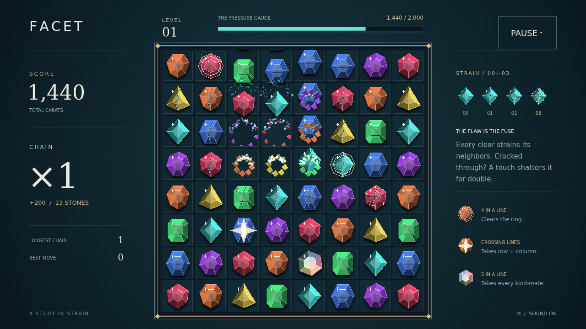

# Facet

A quiet bench. Seven kinds of cut stone. One beautiful breaking point. Take hold of a gem, carry it onto its neighbor, and let go: a line of three or more shatters, the stones above fall, and the next possibility arrives from the dark.

The stones you leave behind remember. Every clear presses strain into its neighbors, deepening fine cracks until a gem is flawed. Touch that flaw with another clear and it joins the shatter, worth double. A modest match beside a worn corner can spend all that stored pressure in a sweeping chain.

Longer lines leave something precious. Four stones earn a brilliant that breaks the ring around it. Crossing lines leave a star that takes its whole row and column. Five or more leave a turning prism: trade it against a stone to shatter every stone of that kind. Let the falling board carry the chain onward, climbing a brighter note and a bigger multiplier with every step.

Reach each level’s target, take stock of your best move and longest chain, then begin again on a fresh field. There is no timer to outrun. Read the cuts, find the flaw, and keep the round alive until there is no productive move left.

